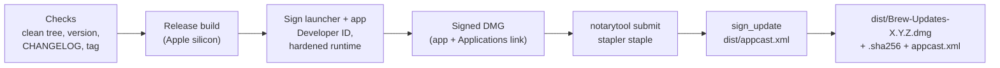

# Deployment Guide

This document explains how to deploy and update Brew Updates (the update script and the app).

## Overview

The script lives in three places:

1. **Development/Source**: `~/Documents/my-projects/scripts/brewUpdates/`
   - Where you edit and update the script
   - Where the git repository lives
   - Contains `brew-updates.sh`, `setup.sh`, and configuration

2. **App-installed copy**: `~/Library/Application Support/Brew Updates/brew-updates.sh`
   - The Brew Updates app bundles the script and installs it here every time it opens and
     finds this copy missing or different, so the app and script always match
   - The LaunchAgent (`com.jxman.brew-updates`) and the app run this copy
   - To deploy a script change: `./scripts/install-app.sh`, then open the app

3. **Command-line copy**: `~/bin/brew-updates.sh`
   - Deployed by `setup.sh`, for running by hand and for script-only use without the app
   - Scheduled runs use it only when the app isn't installed

> **Label change (script 2.7.0 / app 1.5.0):** the LaunchAgent was `com.user.brew-update`.
> The app and `setup.sh` move it to `com.jxman.brew-updates`, keeping the schedule and its
> on/off state, and rename the old plist to `com.user.brew-update.plist.migrated`.

## Initial Setup

When setting up for the first time:

```bash
cd ~/Documents/my-projects/scripts/brewUpdates
./scripts/setup.sh
```

This will:
- ✅ Copy `brew-updates.sh` to `~/bin/`
- ✅ Install the LaunchAgent configuration
- ✅ Create necessary directories (`~/.brew_logs`, `~/.brew_backups`)
- ✅ Create a sample config file (`~/.brew_update_config`)
- ✅ Verify all dependencies

## Updating the Script

**Whenever you edit `brew-updates.sh` in the project directory:**

### Option 1: Run setup.sh (Recommended)

```bash
cd ~/Documents/my-projects/scripts/brewUpdates
./scripts/setup.sh
```

This is the safest method because it:
- Backs up the current `~/bin/brew-updates.sh`
- Verifies the copy with MD5 checksum
- Reloads the LaunchAgent if needed
- Shows you a summary of what changed

### Option 2: Manual copy

```bash
cp ~/Documents/my-projects/scripts/brewUpdates/brew-updates.sh ~/bin/
chmod +x ~/bin/brew-updates.sh
```

Then verify the copy:
```bash
md5 ~/Documents/my-projects/scripts/brewUpdates/brew-updates.sh ~/bin/brew-updates.sh
```

Both should show the same MD5 hash.

## Testing Changes

### Before Deploying (Dry Run)

Test in the development directory without making changes:

```bash
cd ~/Documents/my-projects/scripts/brewUpdates
./brew-updates.sh --dry-run --verbose
```

### After Deploying (Production Test)

Test the deployed version:

```bash
~/bin/brew-updates.sh --dry-run --verbose
```

Or run a real update:

```bash
~/bin/brew-updates.sh --yes --verbose
```

### Test LaunchAgent

Manually trigger the LaunchAgent to test the scheduled job:

```bash
launchctl start com.jxman.brew-updates
```

Watch the logs in real-time:

```bash
tail -f ~/.brew_logs/launchagent.log
```

## Deployment Workflow

**Recommended workflow for making changes:**

1. **Edit** the script in the project directory:
   ```bash
   code ~/Documents/my-projects/scripts/brewUpdates/brew-updates.sh
   ```

2. **Test** locally with dry-run:
   ```bash
   cd ~/Documents/my-projects/scripts/brewUpdates
   ./brew-updates.sh --dry-run --verbose
   ```

3. **Deploy** to production:
   ```bash
   ./scripts/setup.sh
   ```

4. **Verify** the deployment:
   ```bash
   md5 ~/Documents/my-projects/scripts/brewUpdates/brew-updates.sh ~/bin/brew-updates.sh
   ```

5. **Test** the deployed version:
   ```bash
   ~/bin/brew-updates.sh --dry-run --verbose
   ```

6. **Commit** your changes to git:
   ```bash
   git add brew-updates.sh
   git commit -m "feat: description of your changes"
   git push
   ```

## LaunchAgent Management

### Check if LaunchAgent is running

```bash
launchctl list | grep brew-update
```

Output example:
```
PID    Status  Label
-      0       com.jxman.brew-updates
```

### View LaunchAgent schedule

```bash
cat ~/Library/LaunchAgents/com.jxman.brew-updates.plist
```

### Manually trigger a run

```bash
launchctl start com.jxman.brew-updates
```

### Disable LaunchAgent

```bash
launchctl unload ~/Library/LaunchAgents/com.jxman.brew-updates.plist
```

### Re-enable LaunchAgent

```bash
launchctl load ~/Library/LaunchAgents/com.jxman.brew-updates.plist
```

### Update LaunchAgent configuration

After editing `com.jxman.brew-updates.plist`:

```bash
launchctl unload ~/Library/LaunchAgents/com.jxman.brew-updates.plist
launchctl load ~/Library/LaunchAgents/com.jxman.brew-updates.plist
```

Or just run:
```bash
./scripts/setup.sh
```

## Custom Schedules

The app's Settings → Schedule tab is the easiest way to change the schedule. It rewrites the plist (keeping a `.app-backup`) and reloads it. To edit by hand, change `StartCalendarInterval` in `~/Library/LaunchAgents/com.jxman.brew-updates.plist` (not the sample in `examples/`):

```xml
<!-- Daily at 3:00 AM (the default) -->
<key>StartCalendarInterval</key>
<dict>
    <key>Hour</key>
    <integer>3</integer>
    <key>Minute</key>
    <integer>0</integer>
</dict>

<!-- Every Sunday at noon (Weekday: 0=Sunday … 6=Saturday) -->
<key>StartCalendarInterval</key>
<dict>
    <key>Weekday</key>
    <integer>0</integer>
    <key>Hour</key>
    <integer>12</integer>
</dict>

<!-- Monday 9 AM and Friday 5 PM -->
<key>StartCalendarInterval</key>
<array>
    <dict>
        <key>Weekday</key>
        <integer>1</integer>
        <key>Hour</key>
        <integer>9</integer>
    </dict>
    <dict>
        <key>Weekday</key>
        <integer>5</integer>
        <key>Hour</key>
        <integer>17</integer>
    </dict>
</array>
```

Then reload it (not while a run is in progress, because `bootout` stops it):

```bash
launchctl bootout gui/$(id -u)/com.jxman.brew-updates
launchctl bootstrap gui/$(id -u) ~/Library/LaunchAgents/com.jxman.brew-updates.plist
```

`setup.sh` keeps the edited plist on later deploys. `./scripts/setup.sh --reset-launchagent` restores the default.

### Cron (Linux, or instead of the LaunchAgent)

On macOS, cron needs Full Disk Access and doesn't catch up on runs missed while the Mac was asleep, so the LaunchAgent is preferred.

```bash
crontab -e
0 3 * * *   ~/bin/brew-updates.sh --yes >> ~/.brew_logs/cron.log 2>&1   # daily 3 AM
0 9 * * 1,5 ~/bin/brew-updates.sh --yes                                 # Mon + Fri 9 AM
```

## Releasing the app

`scripts/release.sh` makes the download for other Macs: an Apple silicon Release build, signed with Developer ID and the hardened runtime, in a signed DMG that Apple
has notarized. `scripts/install-app.sh` stays the everyday install for this Mac.



In-app updates use [Sparkle](https://sparkle-project.org): the app's `SUFeedURL` is
`releases/latest/download/appcast.xml`, so uploading the DMG and `dist/appcast.xml` to the
same GitHub release is what offers the update to everyone. Sparkle installs it only when its
EdDSA signature matches `SUPublicEDKey` (project.yml) and the new app has the same team ID.

### One-time setup

1. Join the Apple Developer Program (individual).
2. In Xcode: **Settings → Accounts**, add your Apple ID, then **Manage Certificates → + →
   Developer ID Application**. Check it's in the keychain:
   `security find-identity -v -p codesigning`
3. Create an app-specific password at [account.apple.com](https://account.apple.com) (Sign-In
   and Security → App-Specific Passwords), then store the notarization credentials in the
   keychain. Your team ID is the 10 characters in brackets after the certificate's name:

   ```bash
   xcrun notarytool store-credentials brew-updates-notary \
       --apple-id <your Apple ID> --team-id <team ID> --password <app-specific password>
   ```

4. The Sparkle update key (done 2026-11-20). Sparkle's `generate_keys --account brew-updates`
   put the private key in the login keychain ("Private key for signing Sparkle updates") and
   printed the public key that's in `project.yml`. The tools are in
   `~/Library/Developer/Xcode/DerivedData/BrewUpdates-*/SourcePackages/artifacts/sparkle/Sparkle/bin/`.
   **Back the private key up**: without it no installed copy accepts another update.

   ```bash
   generate_keys --account brew-updates -x brew-updates-sparkle-key.txt   # export, then store it in a password manager and delete the file
   generate_keys --account brew-updates -f brew-updates-sparkle-key.txt   # restore on a new Mac
   ```

   The first release asks to let `sign_update` use the key: enter the login password and
   choose Always Allow.

### Each release

1. Bump `MARKETING_VERSION` in `app/project.yml`, move the CHANGELOG's Unreleased section to
   `## [App X.Y.Z] - <date>`, and commit (`chore(app): release app X.Y.Z`).
2. Run `./scripts/release.sh`. It refuses to run with uncommitted changes, without that
   CHANGELOG section, or when the `app-vX.Y.Z` tag already points at another commit.
   Notarization usually takes a few minutes; if Apple rejects it, the script prints the
   `notarytool log` command that shows why.
3. Tag and push: `git tag -a app-vX.Y.Z -m "Brew Updates app X.Y.Z" && git push origin app-vX.Y.Z`.
4. Publish both files in one GitHub release (this is what existing installs update to):
   `gh release create app-vX.Y.Z dist/Brew-Updates-X.Y.Z.dmg dist/appcast.xml --title "Brew Updates X.Y.Z" --notes-file dist/release-notes.md`. The notes are `docs/release-notes-template.md` (install steps) plus the CHANGELOG section, written by release.sh
5. Update the Homebrew cask (`jxman/homebrew-tap`): `./scripts/update-cask.sh`. It downloads
   the published DMG, sets `version` and `sha256` in `Casks/brew-updates.rb`, runs `brew style`,
   commits and pushes. Installed copies don't need it (the app updates itself; the cask says
   `auto_updates true`), but new `brew install --cask` users get the current version.
6. Test the DMG on a fresh Mac: clone the base VM image (see the test VM notes), download the
   DMG there through a browser so it's quarantined like a real download, and open it.

**Testing the pipeline without Developer ID:** `./scripts/release.sh --identity "Apple
Development" --skip-notarize --allow-dirty` builds and signs everything with the development
certificate. Other Macs block that DMG, but it checks the build, signing and DMG steps.

**Testing an update in a VM:** install a test build, then build a "newer" one with
`--build-number <higher> --download-url-prefix http://192.168.64.1:8765/` and serve
`dist/` there (`python3 -m http.server 8765 --bind 192.168.64.1`). In the VM, point the
app at that feed: `defaults write com.jxman.BrewUpdates SUFeedURL http://192.168.64.1:8765/appcast.xml`
(remove it afterwards with `defaults delete com.jxman.BrewUpdates SUFeedURL`), then use
Check for App Updates….

Switching from the Apple Development to the Developer ID identity may make macOS ask for
notification permission once more.

## Uninstalling

### Complete Uninstall (Remove Everything)

Remove the script, LaunchAgent, and all data files:

```bash
cd ~/Documents/my-projects/scripts/brewUpdates
./scripts/setup.sh --uninstall --all
```

Or use the uninstall script directly:

```bash
./scripts/uninstall.sh --all
```

This removes:
- ✓ Installed script (`~/bin/brew-updates.sh`)
- ✓ LaunchAgent configuration
- ✓ Log files (`~/.brew_logs/`)
- ✓ Backup files (`~/.brew_backups/`)
- ✓ Configuration file (`~/.brew_update_config`)

### Partial Uninstall (Keep Data)

Remove only the script and LaunchAgent, preserving your logs, backups, and config:

```bash
./scripts/uninstall.sh
```

This preserves your data while removing the active installation.

### Selective Uninstall

Remove specific components:

```bash
# Remove script/LaunchAgent and logs only (keep backups and config)
./scripts/uninstall.sh --logs

# Remove script/LaunchAgent and backups only
./scripts/uninstall.sh --backups

# Remove script/LaunchAgent and config only
./scripts/uninstall.sh --config

# Remove logs and backups (keep config)
./scripts/uninstall.sh --logs --backups
```

### Dry Run (Preview)

See what would be removed without actually removing it:

```bash
./scripts/uninstall.sh --dry-run --all
```

### Uninstall Options

| Option | Description |
|--------|-------------|
| `--logs` | Remove log directory (`~/.brew_logs`) |
| `--backups` | Remove backup directory (`~/.brew_backups`) |
| `--config` | Remove config file (`~/.brew_update_config`) |
| `--all` | Remove everything (script, LaunchAgent, and all data) |
| `--dry-run` | Preview what would be removed |
| `--force` | Skip confirmation prompts |
| `-h, --help` | Show help message |

### Reinstalling After Uninstall

To reinstall after uninstalling:

```bash
cd ~/Documents/my-projects/scripts/brewUpdates
./scripts/setup.sh
```

Your previous config will be restored if you didn't use `--config` during uninstall.

## File Locations

### Source Files (Development)
```
~/Documents/my-projects/scripts/brewUpdates/
├── brew-updates.sh          # Main script (edit here)
├── scripts/                       # Management scripts
│   ├── setup.sh                   # Deployment script (writes the LaunchAgent plist)
│   ├── uninstall.sh               # Uninstall script
│   ├── install-app.sh             # Build and install the app
│   └── fix-vulnerabilities.sh     # Utility script
├── examples/                      # Config and LaunchAgent plist samples
├── docs/DEPLOYMENT.md             # This file
├── README.md                      # User documentation
└── CLAUDE.md                      # Claude Code instructions
```

### Deployed Files (Production)
```
~/bin/
└── brew-updates.sh           # Deployed script (DO NOT EDIT)

~/Library/LaunchAgents/
└── com.jxman.brew-updates.plist     # Active LaunchAgent config

~/.brew_logs/
├── brew_update_YYYYMMDD_HHMMSS.log           # Main logs
├── brew_update_YYYYMMDD_HHMMSS.upgrades.log  # Upgrade details
├── brew_update_YYYYMMDD_HHMMSS.security.log  # Security scan
├── brew_update_YYYYMMDD_HHMMSS.doctor.log    # Health check
├── launchagent.log                            # LaunchAgent stdout
└── launchagent_error.log                      # LaunchAgent stderr

~/.brew_backups/
└── brew_backup_YYYYMMDD_HHMMSS    # Brewfile backups

~/.brew_update_config              # User configuration
```

## Troubleshooting

### Script versions don't match

**Problem**: Running `~/bin/brew-updates.sh` shows old behavior

**Solution**:
```bash
cd ~/Documents/my-projects/scripts/brewUpdates
./scripts/setup.sh
```

### LaunchAgent not running

**Problem**: Script doesn't run at 3:00 AM

**Check**:
```bash
launchctl list | grep brew-update
```

**Fix**:
```bash
launchctl load ~/Library/LaunchAgents/com.jxman.brew-updates.plist
```

### Permission denied

**Problem**: `./scripts/setup.sh` or `./brew-updates.sh` gives permission error

**Fix**:
```bash
chmod +x ~/Documents/my-projects/scripts/brewUpdates/scripts/setup.sh
chmod +x ~/Documents/my-projects/scripts/brewUpdates/scripts/uninstall.sh
chmod +x ~/Documents/my-projects/scripts/brewUpdates/brew-updates.sh
```

### Logs not showing updates

**Problem**: LaunchAgent runs but logs are empty or incomplete

**Check**:
1. Verify script version matches:
   ```bash
   md5 ~/Documents/my-projects/scripts/brewUpdates/brew-updates.sh ~/bin/brew-updates.sh
   ```

2. Check LaunchAgent is using correct path:
   ```bash
   grep ProgramArguments ~/Library/LaunchAgents/com.jxman.brew-updates.plist -A 5
   ```

3. Manually test the deployed script:
   ```bash
   ~/bin/brew-updates.sh --yes --verbose
   ```

## Best Practices

1. **Always use setup.sh after editing the script** - Don't manually copy files
2. **Test with --dry-run first** - Verify changes before running for real
3. **Check MD5 checksums** - Ensure source and deployed versions match
4. **Review logs after LaunchAgent runs** - Verify everything worked
5. **Keep the project in version control** - Git tracks your changes
6. **Document changes in commits** - Use clear commit messages
7. **Never edit ~/bin/brew-updates.sh directly** - Always edit the source

## Quick Reference

| Task | Command |
|------|---------|
| Deploy script | `cd ~/Documents/my-projects/scripts/brewUpdates && ./scripts/setup.sh` |
| Test locally | `./brew-updates.sh --dry-run --verbose` |
| Test deployed | `~/bin/brew-updates.sh --dry-run --verbose` |
| Verify checksums | `md5 ~/Documents/my-projects/scripts/brewUpdates/brew-updates.sh ~/bin/brew-updates.sh` |
| Check LaunchAgent | `launchctl list \| grep brew-update` |
| Trigger now | `launchctl start com.jxman.brew-updates` |
| View logs | `tail -f ~/.brew_logs/launchagent.log` |
| Edit config | `nano ~/.brew_update_config` |
| Uninstall (keep data) | `./scripts/uninstall.sh` |
| Uninstall (remove all) | `./scripts/setup.sh --uninstall --all` |
| Preview uninstall | `./scripts/uninstall.sh --dry-run --all` |

## Automation Options

### Option 1: Git Hook (Recommended)

Create `.git/hooks/post-merge` to auto-deploy after git pull:

```bash
#!/bin/bash
cd ~/Documents/my-projects/scripts/brewUpdates
./scripts/setup.sh
```

### Option 2: Watch Script

Use `fswatch` to auto-deploy on file changes:

```bash
brew install fswatch
fswatch -o ~/Documents/my-projects/scripts/brewUpdates/brew-updates.sh | \
  xargs -n1 -I{} ~/Documents/my-projects/scripts/brewUpdates/scripts/setup.sh
```

### Option 3: Alias

Add to your `~/.zshrc` or `~/.bashrc`:

```bash
alias deploy-brew='cd ~/Documents/my-projects/scripts/brewUpdates && ./scripts/setup.sh'
```

Then just run:
```bash
deploy-brew
```

## See Also

- [README.md](../README.md) - User documentation
- [CLAUDE.md](../CLAUDE.md) - Development guidelines
- [CHANGELOG.md](../CHANGELOG.md) - Version history
